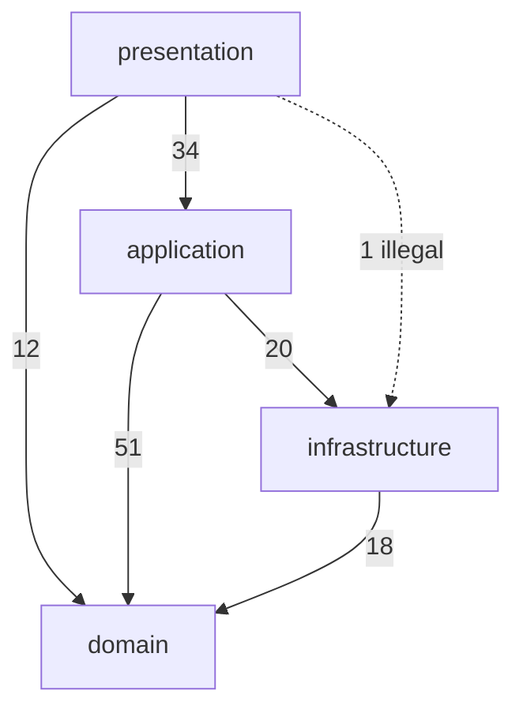

# 4layers

> Keep your frontend layers honest — at dev time, at build time, and in CI.

A layered architecture only works while everyone respects the arrows. One
`import axios from 'axios'` in a component, one `import { useCart } from '@/stores/cart'`
in a repository, and the boundaries quietly stop existing.

`4layers` checks the boundaries for you:

```
┌─────────────────────────────────────────────────────────────────┐
│  presentation    components, views, layouts, user interaction   │
│        │                                                        │
│        ▼                                                        │
│  application     stores, composables, routing, queries          │
│        │                                                        │
│        ▼                                                        │
│  domain      ◄── entities, use cases, pure business rules       │
│        ▲                                                        │
│        │                                                        │
│  infrastructure  HTTP, storage, SDKs, edge functions            │
└─────────────────────────────────────────────────────────────────┘
```

- **Vite plugin** — a forbidden import fails the build, and shows up in the dev
  overlay the moment you save.
- **CLI** — `4layers check` for CI, with GitHub annotations and JSON output.
- **Zero runtime dependencies**, `.vue` SFCs understood natively, works with
  plain JS, TS, JSX and TSX too.
- **Convention over configuration** — the default preset already knows what
  `src/components`, `src/stores`, `src/domain` and `src/api` mean.

## Install

```bash
npm install --save-dev 4layers
```

## Quick start

```bash
npx 4layers check
```

That is already useful with no config at all: the `classic` preset plus the
conventional Vue directory layout.

```
src/api/cart.ts [infrastructure]
  4:1  error  infrastructure may not import application ("@/stores/cart" resolves to src/stores/cart.ts).  layer-dependency
         -> infrastructure may import: domain. Infrastructure should expose data and let application call it, not the other way round.

src/components/CartView.vue [presentation]
  13:1  error  presentation may not import infrastructure ("@/api/cart" resolves to src/api/cart.ts).  layer-dependency
         -> presentation may import: application, domain. Put the call in an application-layer store or composable and let the component consume that.
  15:1  error  The presentation layer may not import "axios".  package-boundary
         -> Move "axios" behind the application layer so the component only talks to state and use cases.

3 errors · 42 files, 118 imports in 31ms
```

Write a config when your layout differs:

```bash
npx 4layers init
```

## Use it with Vue

Add the plugin to `vite.config.ts`. It runs with `enforce: 'pre'`, so `.vue`
files are checked as real SFCs before `@vitejs/plugin-vue` takes them apart.

```ts
import { defineConfig } from 'vite';
import vue from '@vitejs/plugin-vue';
import fourLayers from '4layers/vite';

export default defineConfig({
  plugins: [
    vue(),
    fourLayers({
      // dev:   'overlay' (default) | 'warn' | 'off'
      // build: 'error'   (default) | 'warn' | 'off'
    }),
  ],
});
```

During `vite dev` a violation is logged and raised through Vite's error
overlay, pointing at the exact line. During `vite build` the whole project is
checked once and the build fails. Set `dev: 'warn'` while you are migrating.

## How a file gets its layer

A file belongs to the layer whose **most specific** matching glob claims it —
not the first one declared. That is what lets the default preset give every
`**/*.vue` file to the presentation layer while an explicit `src/domain/**`
still wins for a `.vue` file that happens to live in the domain.

Defaults from the built-in presets:

| Layer            | Default globs                                                                                                |
| ---------------- | ------------------------------------------------------------------------------------------------------------ |
| `presentation`   | `src/components/**`, `src/views/**`, `src/pages/**`, `src/layouts/**`, `src/ui/**`, `src/presentation/**`, `**/*.vue` |
| `application`    | `src/application/**`, `src/stores/**`, `src/composables/**`, `src/queries/**`, `src/mutations/**`, `src/router/**`, `src/app/**` |
| `domain`         | `src/domain/**`, `src/entities/**`, `src/models/**`, `src/use-cases/**`, `src/usecases/**`                    |
| `infrastructure` | `src/infrastructure/**`, `src/infra/**`, `src/api/**`, `src/http/**`, `src/services/**`, `src/repositories/**`, `src/adapters/**`, `src/storage/**`, `src/gateways/**` |

Not sure where a file landed? Ask:

```bash
npx 4layers explain src/stores/cart.ts
```

```
src/stores/cart.ts
  layer:      application  (matched src/stores/**)
  may import: domain, infrastructure
  role:       Application-specific orchestration: state, routing, workflows, data fetching.
  status:     clean
```

Aliases are picked up automatically from `tsconfig.json`/`jsconfig.json`
`paths` and from Vite's own `resolve.alias`, so `@/stores/cart` resolves the
same way your bundler resolves it.

## Rules

| Rule                | Checks                                                             | `classic` |
| ------------------- | ------------------------------------------------------------------ | --------- |
| `layer-dependency`  | An import crosses a layer boundary that `canImport` does not allow. | `error`   |
| `package-boundary`  | A layer imports an external package its policy forbids.             | `error`   |
| `unassigned-file`   | A scanned file belongs to no layer.                                 | `off`     |
| `unresolved-import` | A relative or aliased specifier resolves to nothing.                | `off`     |
| `self-import`       | A layer imports itself while `allowSelfImports: false`.             | `off`     |
| `unknown-layer`     | A `canImport` entry names a layer that does not exist.              | `warn`    |

### Package boundaries

Layer rules stop internal imports from crossing boundaries. Package policies
stop the outside world from leaking in — which is how you actually keep a
domain layer framework-agnostic:

```ts
layers: {
  domain: {
    // Nothing from node_modules at all.
    packages: { allow: [] },
  },
  presentation: {
    // No HTTP clients in components.
    packages: { deny: ['axios', 'ky', '@supabase/*', 'firebase'] },
  },
}
```

`allow` is a whitelist (set it and everything else is rejected), `deny` is a
blacklist, and `deny` wins. Patterns match both the package name and the full
specifier, so `@firebase/*` and `firebase/firestore` both work.

## Presets

```ts
export default defineConfig({ extends: 'classic' });
```

| Preset    | Dependency edges                                                                     | Notes                                                                   |
| --------- | ------------------------------------------------------------------------------------ | ----------------------------------------------------------------------- |
| `strict`  | presentation→application, application→domain, infrastructure→domain                  | Infrastructure is injected, never imported. Domain imports no packages. Every file must have a layer. |
| `classic` | presentation→application+domain, application→domain+infrastructure, infrastructure→domain | The pragmatic default.                                              |
| `relaxed` | same as `classic`                                                                    | Everything reported as warnings, type-only imports ignored. Good for adoption. |

## Configuration

`4layers.config.ts`, `.mts`, `.mjs`, `.js`, `.cjs`, `.json`, `.4layersrc.json`
or a `"4layers"` key in `package.json`. Everything is optional and merged over
the preset.

```ts
import { defineConfig } from '4layers';

export default defineConfig({
  extends: 'classic',

  include: ['src/**/*.{js,ts,jsx,tsx,vue}'],
  exclude: ['**/*.spec.*', '**/__tests__/**'],

  // Merged over the preset: list only what differs.
  layers: {
    presentation: {
      files: ['src/components/**', 'src/views/**', '**/*.vue'],
      exclude: ['src/components/__fixtures__/**'],
      canImport: ['application', 'domain'],
      packages: { deny: ['axios', '@supabase/*'] },
      description: 'Dumb components. Props in, events out.',
    },
    application: {
      files: ['src/stores/**', 'src/composables/**'],
      canImport: ['domain', 'infrastructure'],
    },
    domain: {
      files: ['src/domain/**'],
      canImport: [],
      packages: { allow: ['zod', 'date-fns'] },
    },
    infrastructure: {
      files: ['src/api/**', 'src/storage/**'],
      canImport: ['domain'],
    },

    // Extra layers are fine — the four are just the default.
    shared: {
      files: ['src/shared/**'],
      canImport: [],
    },
  },

  // Usually inferred from tsconfig paths; override when needed.
  aliases: { '@': 'src' },

  // 'check' (default) holds `import type` to the same rules; 'ignore' exempts it.
  typeOnlyImports: 'check',

  allowSelfImports: true,

  severity: {
    'layer-dependency': 'error',
    'package-boundary': 'error',
    'unassigned-file': 'warn',
  },
});
```

`canImport: ['*']` allows every layer. `canImport: []` allows none — that is
the domain layer's whole point.

## Escape hatches

For the import you have to live with today:

```ts
// 4layers-disable-next-line layer-dependency
import { legacyFetch } from '@/api/legacy';

// 4layers-disable-next-line
import { other } from '@/api/other';
```

And for a file you will deal with later:

```ts
// 4layers-disable-file
```

`4layers-ignore-next-line` and `4layers-ignore-file` work the same way.

## CI

```yaml
- run: npx 4layers check --format github
```

`--format github` emits workflow commands, so every violation annotates the
line in the pull request diff. The command exits `1` when there are errors
(or when warnings exceed `--max-warnings`), `2` on a usage or config error.

Adopting on an existing codebase? Start permissive and tighten:

```bash
npx 4layers check --preset relaxed --max-warnings 120
```

## Architecture diagrams

```bash
npx 4layers graph > docs/layers.mmd            # mermaid
npx 4layers graph --format dot | dot -Tsvg -o docs/layers.svg
```

The graph shows the declared edges with their real usage counts, and dashes the
illegal edges it actually found:



## CLI reference

```
4layers check [files...]     Check the project (default command)
4layers graph                Print the layer dependency graph
4layers explain <file>       Show which layer owns a file, and why
4layers init                 Write a starter 4layers.config.mjs

--root <dir>         Project root (default: cwd)
--config <file>      Path to a config file
--preset <name>      strict | classic | relaxed (overrides config)
--format <name>      pretty | compact | json | github | mermaid | dot
--max-warnings <n>   Fail when warnings exceed n
--stats              Print the per-layer table
--quiet              Only print the summary
--no-hints           Hide the "how to fix" hints
```

## Programmatic API

```ts
import { check, createChecker, resolveConfig } from '4layers';

const result = await check({ root: process.cwd() });
console.log(result.errorCount, result.edges);

// Or check a single buffer, e.g. from an editor extension.
const checker = createChecker(resolveConfig({ extends: 'strict' }, { root: process.cwd() }));
const violations = checker.checkFile('src/components/Cart.vue', source);
```

Also exported: `createResolver`, `createLayerIndex`, `scanImports`,
`walkProject`, `createMatcher`, every formatter, and all the types.

## How it works, and what it does not do

Imports are found by scanning source text with comments masked out and, for
`.vue` files, only inside `<script>` blocks — no AST, no parser dependency,
fast enough to run on every keystroke-save. That is a deliberate trade:

- An import written inside a template literal could produce a false positive.
- Dynamic specifiers (`import(someVariable)`) cannot be judged, so they are
  skipped rather than guessed at.
- It checks module boundaries, not semantics: it cannot tell you that a domain
  entity is secretly holding a DOM node.

Type-only imports are detected (`import type`, and named clauses where every
specifier is `type`-prefixed) and, by default, held to the same rules — a
presentation component importing an infrastructure DTO type is still coupling.
Set `typeOnlyImports: 'ignore'` if you disagree.

## Roadmap

- ESLint flat-config plugin, for editor squiggles without Vite.
- `4layers check --changed` against a git ref, for large monorepos.
- Nuxt module.
- Per-file dependency graph output, not just per-layer.

## Contributing

See [CONTRIBUTING.md](CONTRIBUTING.md). `npm install && npm test` is the whole
setup; the package has no runtime dependencies and intends to keep it that way.

## License

[MIT](LICENSE)
